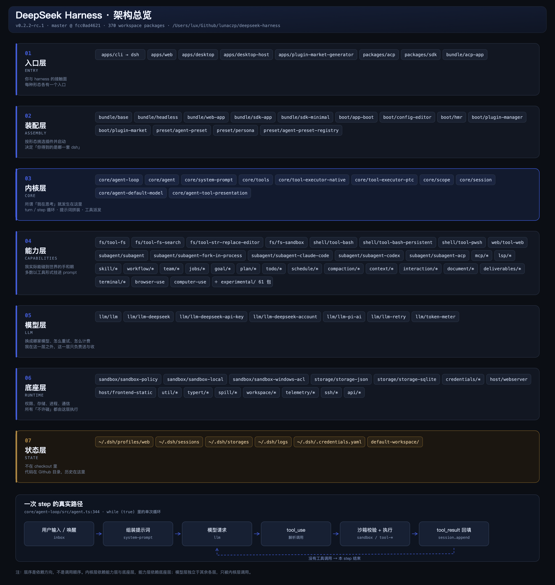

# DSH 七层架构



矢量版：[dsh-architecture.svg](./assets/dsh-architecture.svg)

> 版本：`v0.2.2-rc.1`，master `fcc0ad4621`，370 个 workspace 包。

## 怎么读这张图

**纵轴是依赖方向，不是调用顺序。** 上面依赖下面。

| 层 | 职责 | 代表包 |
|---|---|---|
| 01 入口层 | 与用户/外部的接触面 | `apps/cli`、`apps/web`、`apps/desktop`、`packages/acp`、`packages/sdk` |
| 02 装配层 | 按形态挑选插件并启动 | `bundle/*`、`boot/app-boot`、`boot/plugin-manager`、`preset/*` |
| 03 内核层 | turn/step 循环、提示词拼装、工具派发 | `core/agent-loop`、`core/system-prompt`、`core/tools`、`core/tool-executor-*` |
| 04 能力层 | agent 实际能碰到世界的手和眼 | `fs/*`、`shell/*`、`subagent/*`、`mcp`、`skill`、`workflow`、`goal` |
| 05 模型层 | 换成哪家模型、怎么重试、怎么计费 | `llm/*`、`token-meter` |
| 06 底座层 | 权限、存储、进程、通信 | `sandbox/*`、`storage/*`、`credentials`、`host/webserver` |
| 07 状态层 | **不在 checkout 里**：会话、配置、日志 | `~/.dsh`、工作区目录 |

## 三个要点

**内核层与模型层的分界，就是"可观测"与"不可观测"的分界。** 03 层的每一步都是本地可读的 TypeScript；05 层之上发生的事（token 生成）没有自省通道。

**代码与数据分离。** 代码在 checkout（只读，改需提权），会话与配置在 `~/.dsh`。两者不能混。

**底部虚线闭环是单个 step 的形状。** 没有工具调用就结束这一步，有就回到模型再来一轮——这就是"连续做十几件事"的机械本质。

## 复现

图由 `gen-arch.py` 生成（SVG），再用 headless Chrome 渲染为 2x PNG。

```bash
python3 gen-arch.py
"Google Chrome" --headless=new --window-size=1560,1645 \
  --force-device-scale-factor=2 \
  --user-data-dir=/tmp/cp --screenshot=dsh-architecture.png \
  file://$PWD/dsh-architecture.svg
```
