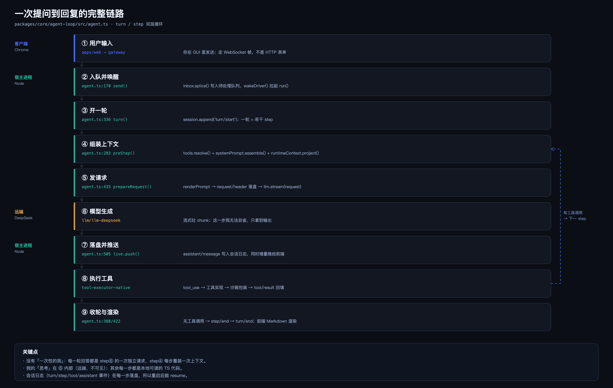

# 一次提问到回复的完整链路

矢量版：[request-lifecycle.svg](./assets/request-lifecycle.svg)

## 九步

| # | 阶段 | 位置 | 动作 |
|---|---|---|---|
| ① | 用户输入 | `apps/web` → `api/gateway` | 走 WebSocket 帧，不是 HTTP 表单 |
| ② | 入队并唤醒 | `agent-loop/src/agent.ts:170` `send()` | `inbox.splice()` 排入队列，`wakeDriver()` 拉起 `run()` |
| ③ | 开一轮 | `agent.ts:336` `turn()` | `session.append('turn/start')`；一轮 = 若干 step |
| ④ | 组装上下文 | `agent.ts:283` `preStep()` | `tools.resolve()` + `systemPrompt.assemble()` + `runtimeContext.project()` |
| ⑤ | 发请求 | `agent.ts:435` `step()` | `renderPrompt` → `request/header` 落盘 → `llm.stream()` |
| ⑥ | 模型生成 | `llm/llm-deepseek` | 流式 chunk；**唯一不可自省的一步** |
| ⑦ | 落盘并推送 | `agent.ts:505` `live.push()` | `assistant/message` 写入日志，同时增量推给前端 |
| ⑧ | 执行工具 | `tool-executor-native` | `tool_use` → 工具实现 → 沙箱包装 → `tool/result` |
| ⑨ | 收轮与渲染 | `agent.ts:388/422` | 无工具调用 → `step/end` → `turn/end`；前端 Markdown 渲染 |

⑧ 之后回到 ④，进入下一个 step。

## 关键认识：没有"一次性的我"

一条回复通常是 N 次独立的模型请求拼成的。每次请求都会重新组装上下文——你的原话、之前的工具结果、刚读到的代码、以及每轮重新注入的 runtime context（包括文件策略、`AGENTS.md`）。

**连续性不是记忆，是日志重放。** `~/.dsh/sessions/<workspace>/session-<id>/session.v4.jsonl.zstd` 里按序存着 `turn/start`、`step/start`、`tool/result`、`assistant/message`、`turn/end`。重启后恢复会话，就是把这段日志重新读回上下文。

## 一次真实测量

在"画流程图"那一轮，agent 实际跑了 **9 个 step**：4 次读代码、1 次写生成器、2 次渲染、1 次读图自检（发现闭环被裁）、1 次修复重渲染。

其中第 7 步是回路价值的最好例证：模型以为图没问题，读图工具指出被裁，于是回到 ④ 重做。**没有这个反馈回路，错误会直接交付。**

## 对自改系统的意义

⑧→④ 的循环体全程在同一个进程内。要替换这段循环，就必须替换整个进程——这正是"自我重启必须外置 supervisor"的原因。
