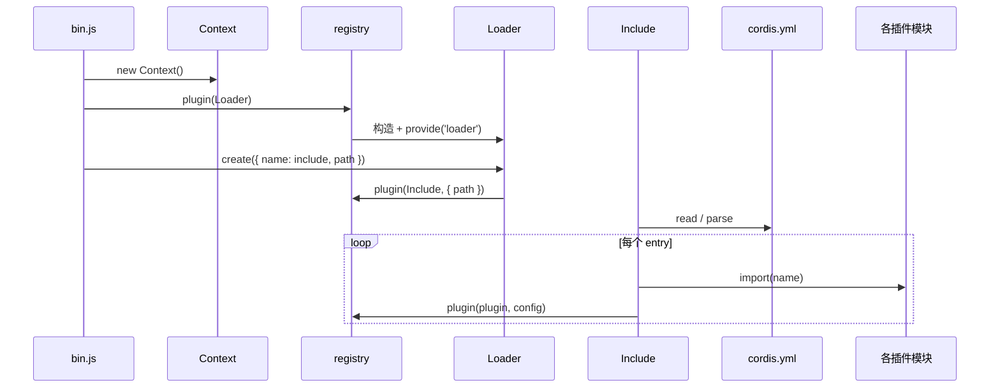

# Cordis 最小启动：bin.js → Loader → Include → 插件树

| | |
|---|---|
| 状态 | 学习中（主链路已走通） |
| 日期 | 2026-11-18 |
| 基线 | `zhp@bc86b89434` |
| 证据 | 源码为主；无本轮对 `cordis` CLI 的实测 |

> 证据约定：**实测** = 本机跑过；**源码** = 读仓库确认；**日志** = 系统/内核日志；**二手** = 外部文档；**推断** = 尚未验证。
> 插件 volatile 配置表单／profile 热改对照 [47](./47-settings.md)。

## 一句话

**官方 `cordis` CLI 只做三件事：建根 Context → `plugin(Loader)` → `loader.create(Include 读 cordis.yml)`；文件里每一行 entry 最终仍是 `registry.plugin`。**（源码）

与 [07-startup.md](./07-startup.md) 对照：DSH 的 `dsh --profile` 多了 profile / 空根 / 多层 patch / `boot()`；**Loader / Entry / `import` → `registry.plugin` 是同一套**。本文只讲 vendor 最小入口。

概念加深：seam ↔ Service → [19](./19-seam-and-service.md)；plugin 两种形态 → [20](./20-plugin-and-service.md)。

## 1. 入口：`vendor/cordis/bin.js`

```js
const ctx = new Context()
ctx.baseUrl = pathToFileURL(process.cwd()).href + '/'

await ctx.plugin(Loader)
await ctx.loader.create({
  name: '@deepseek-ai/cordis-plugin-include',
  config: { path: './cordis.yml' },
})
```

位置：[../vendor/cordis/bin.js](../vendor/cordis/bin.js)

| 步骤 | 含义 |
|---|---|
| `new Context()` | 根容器 + Proxy；内置 `registry` / `events` / `reflect` / `logger`；mixin 出 `ctx.plugin` 等 |
| `baseUrl = cwd/` | 相对模块、相对配置路径的解析根 |
| `ctx.plugin(Loader)` | Loader 当普通插件装上 → `provide('loader')` → `ctx.loader` |
| `ctx.loader.create(Include…)` | 在 Loader **根 EntryGroup** 里加第一条 entry：Include |

CLI **自己不解析 yaml**；硬编码「先 Loader，再 Include 指向 `./cordis.yml`」。（源码）

## 2. Context 侧（启动前的运行时）

理解后续 `ctx.plugin` / `ctx.loader` 时需要这三块（源码：`vendor/cordis`）：

| 机制 | 作用 |
|---|---|
| **Proxy**（`ReflectService.handler`） | `ctx.xxx`：已有字段直接读；否则当**服务名**按 isolate/inject/provide 解析 |
| **mixin** | 把服务方法铺到 `ctx`：`ctx.emit`←`events`，`ctx.plugin`←`registry`，`ctx.provide`←`reflect`… |
| **interface + class `Context`** | interface 是可声明合并的公开形状；class 构造里真正 `new` 服务并 `return` Proxy |

`emit` / `plugin` 等**不是** `Events` 接口上可直接调用的方法；类型表约束 `ctx.emit('…', …)` / `ctx.on('…', …)`。（源码：[`events.ts`](../vendor/cordis/src/events.ts)、[`reflect.ts`](../vendor/cordis/src/reflect.ts)）

## 3. Loader 怎么挂上

`Loader` 继承 `EntryTree`（[`loader/src/index.ts`](../vendor/loader/src/index.ts)）：

1. `provide('loader', this)`；
2. 建内存 entry 树：`root = EntryGroup`，`store = {}`；
3. 挂 `internal/plugin` 等钩子（给 fiber 绑 `entry`、自处置写回 disabled 等）；
4. `ctx.plugin(isolate)`。

根树的 `commit` 在基类 Loader 上是 **no-op**（纯内存）；持久化由 Include 子类覆盖。（源码）

### `loader.create` → 一条 Entry

[`EntryTree.create`](../vendor/loader/src/config/tree.ts) → `EntryGroup.create` → `new Entry` → `entry.update(..., create=true)` → `init()`。

### Entry 真正开跑

[`Entry._init`](../vendor/loader/src/config/entry.ts)：

1. `tree.import(options.name)`（动态 ESM / `cordis:` builtin）；
2. `unwrapExports` 取出插件；
3. `this.fiber = ctx.registry.plugin(plugin, options.config)`。

**Loader 不发明第二种启动方式**；配置树只是驱动「动态 import + 已有的 `registry.plugin`」。（源码）

## 4. Include：`cordis.yml` → 一串 plugin

Include 也是 `EntryTree`，`static inject = ['loader']`（[`include/src/index.ts`](../vendor/include/src/index.ts)）。

`[Service.init]` 大致：

1. 读 `config.path`（相对 `baseUrl`）→ 如 `./cordis.yml`；
2. YAML → `EntryOptions[]`（`id` / `name` / `config` / `disabled` / `group` / `inject`…）；
3. 可选 `patches`、`initial`（缺文件时可写初始内容）；
4. `root.update(tree)`：对每个 id `create` 或 `remove`。

之后每个 entry 再走上一节的 `_init`。

嵌套：`group: true` 的 entry 挂 `Group`，子列表同样 `update`，形成树。（源码）

Include 的 `commit` 会记 journal 并回写文件——这是相对「纯 Loader 根树」的差异；细节见文末「还没搞懂」与 [07](./07-startup.md) 的 patch 问题。

## 5. 时序图



## 6. 三张 API 对照

| API | 谁用 | 结果 |
|---|---|---|
| `ctx.plugin(X)` | 代码直接装 | 一个 Fiber |
| `loader.create({ name, config })` | CLI / 运行时加节点 | Entry + import + 内部仍 `registry.plugin` |
| Include + yaml 列表 | 声明式多插件 | 对每个 `name` 重复上一行 |

## 7. 和 DSH 的边界

| | 本文（`cordis` CLI） | DSH（`07` / `09`） |
|---|---|---|
| 入口 | `vendor/cordis/bin.js` | `apps/cli` → `runProfile` → `boot()` |
| 根配置 | 工作区 `./cordis.yml` | profile 空根 `[]` + 多层 patch |
| 第一颗业务树 | Include 直接读文件 | `mountRootInclude` + bundles / profile / home / `--patch` |
| 就绪 | Create 返回即列表在加载 | `loader.await()` + `auditStartupEntries` |

学 DSH 启动时：先建立本文的 Loader/Entry 心智，再叠 [07](./07-startup.md) 的补丁栈。

事件分发（`emit`／`bail`／`serial`／`waterfall`）：[50-cordis-events.md](./50-cordis-events.md)。
`ctx.effect` 与 Fiber 清理：[51-cordis-effect.md](./51-cordis-effect.md)。

文件级对照与行数：[11-dsh-vs-cordis-boot-files.md](./11-dsh-vs-cordis-boot-files.md)。

## 还没搞懂

1. Include 的 **journal / patch**（insert、override、disable）与 DSH 多层 `cordis.patch.yml` 如何对齐——部分与 [07](./07-startup.md) 待办重复。
2. `EntryTree.import` 的 `cordis:` builtin 与 DSH `PluginPackages` 解析如何衔接。
3. `loader/patch-context` waterfall 在隔离（isolate）场景下如何改 child `ctx` 原型链。
4. Fiber 激活与 `inject` 等待：yaml **行序 ≠ 激活序** 的完整调度图（与 [07](./07-startup.md) §7 呼应）。
